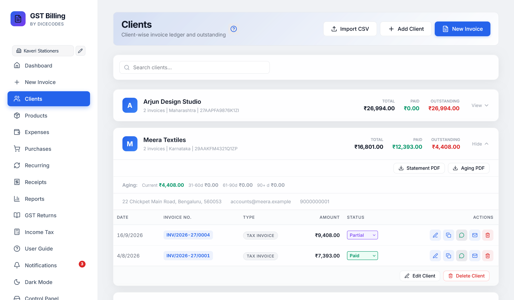
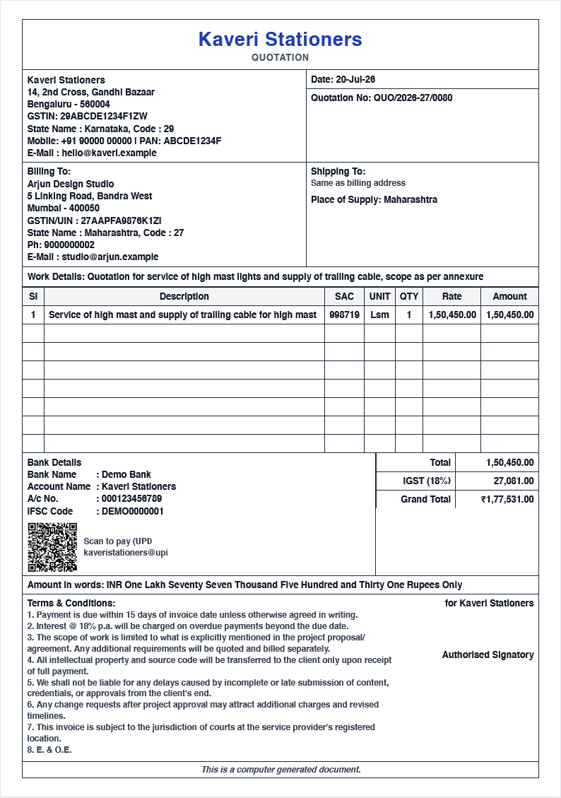
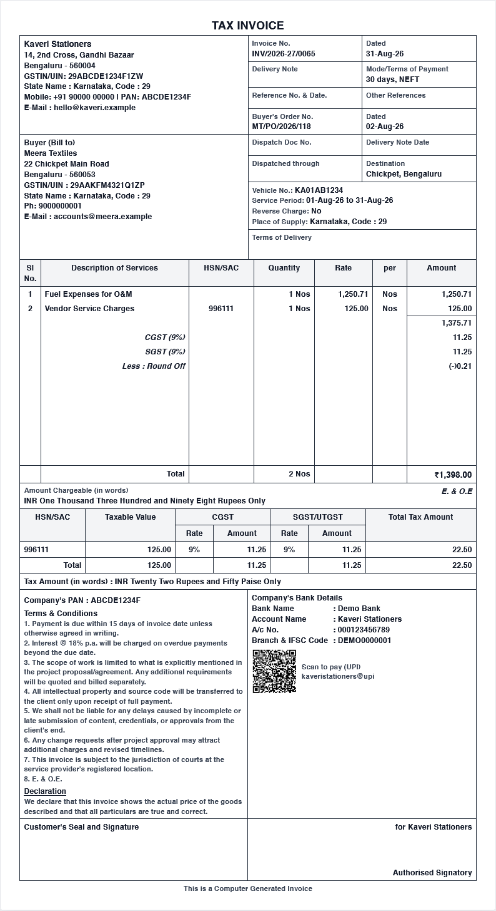
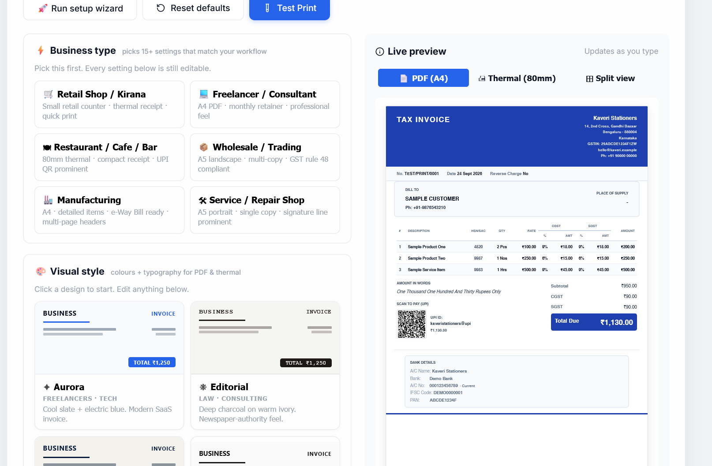

<div align="center">

# Free GST Billing Software (Enterprise Desktop Edition)

### 100% Free, Zero-Subscription, Privacy-First GST Invoicing & Accounting Desktop App

[](LICENSE)
[%20%7C%20Windows%20(.exe)%20%7C%20Linux-brightgreen.svg)](#-installation--downloads)
[](https://github.com/OmRaj6666/GST-Billing-Software-LIFE-TIME-USE-NO-Subscription-Required-/releases/latest)
[](https://react.dev)
[-black.svg)](https://expressjs.com)
[](https://www.electronjs.org)
[](#-security-architecture--audit-report)
[](#-testing--tax-suite-verification)

**Create GST-compliant invoices, file GSTR-1 / GSTR-3B with direct JSON portal exports, reconcile GSTR-2B purchase input tax credit (ITC), compute TDS / TCS, bill international clients in 22 currencies, and calculate Income Tax — completely offline with zero subscription fees.**

Your financial data never leaves your computer. No cloud databases. No signups. No feature paywalls.

[⬇ Download macOS Installer (.dmg)](https://github.com/OmRaj6666/GST-Billing-Software-LIFE-TIME-USE-NO-Subscription-Required-/releases/latest) &nbsp;|&nbsp; [⬇ Download Windows Setup (.exe)](https://github.com/OmRaj6666/GST-Billing-Software-LIFE-TIME-USE-NO-Subscription-Required-/releases/latest) &nbsp;|&nbsp; [🎬 Watch Video Tour](#-1-minute-video-tour-enterprise-desktop-edition) &nbsp;|&nbsp; [📦 All Releases](https://github.com/OmRaj6666/GST-Billing-Software-LIFE-TIME-USE-NO-Subscription-Required-/releases) &nbsp;|&nbsp; [📖 User Guide](public/user-guide.html) &nbsp;|&nbsp; [🐛 Report Issue](https://github.com/OmRaj6666/GST-Billing-Software-LIFE-TIME-USE-NO-Subscription-Required-/issues)

<br/>


<p align="center">
  <strong>Free GST Billing Software - Modern Dashboard Preview</strong>
</p>

<p align="center">
  
</p>


</p>

</div>

---

## 🎬 1-Minute Video Tour (Enterprise Desktop Edition)

> 💡 **Why pay ₹2,599+/year for GST billing?** Watch this fast-paced 78-second feature walkthrough demonstrating the live dashboard, instant GST invoice generation with dynamic UPI QR codes, official portal-ready GSTR-1 / GSTR-3B JSON exports, built-in Income Tax calculator, and 100% offline security.

<div align="center">

https://github.com/user-attachments/assets/a16b13cd-3f82-4096-9f78-42a21a58dbf7

<p align="center">
  <sub>🎥 <em>Click play above for the 1080p Full HD video tour with narration &nbsp;|&nbsp; ⬇ <a href="https://github.com/OmRaj6666/GST-Billing-Software-LIFE-TIME-USE-NO-Subscription-Required-/releases/download/v1.10.82/GST-Billing-Explainer.mp4">Direct MP4 Download (18 MB)</a></em></sub>
</p>

</div>

<details>
<summary><b>⏱️ Video Chapters & Walkthrough Guide (Click to expand)</b></summary>
<br/>

| Timestamp | Chapter | Feature Highlight & What You See |
| :---: | :--- | :--- |
| **`0:00`** | **Stop Yearly Fees** | Why pay ₹2,599+/year just to send GST invoices? There's a better, 100% free way. |
| **`0:06`** | **Introducing Free GST Billing** | Enterprise desktop edition: 100% free for life, zero subscriptions, 100% offline, open source. |
| **`0:12`** | **Real-Time Financial Dashboard** | Instant visibility into monthly turnover, tax collected, pending receivables, and live inventory alerts. |
| **`0:18`** | **Invoicing in Seconds & UPI QR** | Auto-split CGST, SGST, IGST, UTGST, and instant dynamic UPI payment QR codes embedded on every bill. |
| **`0:30`** | **File-Ready GSTR-1 & GSTR-3B** | One-click official schema JSON exports ready to upload directly to `gst.gov.in` without manual entry. |
| **`0:38`** | **Built-in Income Tax Calculator** | Compare Old vs New Tax Regimes, calculate rebates under 87A, and advance tax interest (234A/B/C). |
| **`0:43`** | **All-In-One Power Tools** | E-Way Bill JSON, automated TDS/TCS, GSTR-2B ITC reconciliation, 22 global currencies, and debit/credit notes. |
| **`0:52`** | **Professional Print Formats** | Boxed Elegance, Tally-style Accounting Format, and Thermal POS receipt layouts for retail counters. |
| **`0:59`** | **100% Offline Privacy & PIN Lock** | Your financial data never leaves your computer. No cloud databases, no signups, PIN-lock security. |
| **`1:05`** | **Paid Alternatives Cost Comparison** | Tally Prime (₹22,500+), Zoho Books (₹899+/mo), Vyapar (₹2,599+/yr) vs **Free GST Billing (₹0 forever)**. |
| **`1:12`** | **Free Forever Download** | Standalone installers for macOS (`.dmg`) and Windows (`.exe`), open-source under MIT License. |

</details>

---

## 🌟 Key Highlights

* **100% Offline & Local-First**: No cloud servers or third-party databases. Invoices, client directories, inventory, and accounts reside strictly in human-readable JSON files on your local drive (`data/`).
* **Native Desktop Installers**: Standalone **macOS Apple Silicon installer (`.dmg`)** and **Windows Setup installer (`.exe` / portable)** with native OS window frames, keyboard shortcuts, and hardware acceleration.
* **Complete Indian Tax & Compliance Engine**:
  * **Tax Invoices, Bills of Supply, Proforma Estimates, Delivery Challans, and Credit/Debit Notes**.
  * Dynamic GST auto-split (CGST + SGST for intrastate, IGST for interstate, UTGST for Union Territories, SEZ zero-rated, and LUT exports).
  * Automated **TDS / TCS calculation** (Form 26Q / 27EQ, Section 194Q, Section 206C(1H) with ₹50 Lakh threshold).
  * Reverse Charge Mechanism (RCM), GST Cess, per-line custom units (Kg, Ltr, Nos, Hours, etc.), and 4 distinct discount calculation modes.
* **GST Portal Export Readiness**:
  * One-click **GSTR-1 and GSTR-3B JSON exports** formatted precisely to the official GSTN schema for direct upload to `gst.gov.in`.
  * **GSTR-2B Reconciliation** matching supplier invoices against internal records to maximize Input Tax Credit (ITC).
  * **E-Way Bill JSON generation** (NIC schema v1.0.1221) for outward consignment compliance.
* **Instant Payments via UPI QR**: Auto-embeds dynamic, standard-compliant UPI payment QR codes on invoices linking directly to your bank account.
* **Enterprise Security Hardening**: Anti-DNS Rebinding host verification, strict loopback binding (`127.0.0.1`), scrypt-salted PIN lock with API session tokens, object prototype pollution defenses, and DOMPurify XSS sanitization.

---

## 📸 Application Showcase & Screenshots

### 1. Modern Financial Dashboard
Overview of monthly turnover, unpaid receivables, tax liability split (CGST, SGST, IGST), and real-time transaction logs.

<h2 align="center">Free GST Billing Software</h2>
<p align="center">Modern Dashboard Preview</p>

<p align="center">
  
</p>


---


---


## Application Features & Screenshots

<table>
  <tr>
    <th align="center">Tax Invoice Generator</th>
    <th align="center">GST Return Filing</th>
    <th align="center">Income Tax Calculator</th>
  </tr>
  <tr>
    <td align="center">
      
    </td>
    <td align="center">
      
    </td>
    <td align="center">
      
    </td>
  </tr>
</table>

---


---

### 5. Client Directory, Aging & Ledgers
Track client GSTINs, state codes, credit limits, outstanding balances, and generate date-filtered customer statements.
<p align="center">
  
</p>

---

### 6. Inventory & Real-Time Stock Tracking

Manage product catalogs, HSN/SAC codes, low stock alerts, cost price vs selling price margins, and batch CSV imports.

<p align="center">
  
"
    alt="GST Billing Inventory Dashboard"
    width="840"
    style="border-radius: 8px; border: 1px solid #e2e8f0;"
  />
</p>


---

### 7. Professional Print & Template Formats
Choose between multiple industry-standard print styles including **Boxed Elegance**, **Tally-style Accounting Format**, **Modern Clean**, and **Thermal POS 80mm/58mm** formats.

| Boxed Elegance Template | Tally-Style Format |
| :---: | :---: |
|  |  |

<p align="center">
  
</p>

---

## 📊 Comparison: Free GST Billing Software vs Paid Alternatives

| Feature | **Free GST Billing Software** | Tally Prime | Vyapar | Zoho Books | ClearTax GST |
| :--- | :---: | :---: | :---: | :---: | :---: |
| **Price** | ✅ **Free forever** | ₹22,500–₹67,500 | ₹2,599+/year | ₹899–₹2,999/mo | ~₹3,599/year+ |
| **GST Invoices (CGST/SGST/IGST)** | ✅ Full Support | ✅ Supported | ✅ Supported | ✅ Supported | ✅ Supported |
| **UTGST for Union Territories** | ✅ Auto-detected | ⚠ Manual config | ❌ Not available | ⚠ Manual | ⚠ Manual |
| **GSTR-1 & GSTR-3B JSON Export** | ✅ One-Click Official | ✅ Paid tier | ⚠ CSV only | ✅ Standard+ | ✅ Supported |
| **GSTR-2B ITC Reconciliation** | ✅ Built-in Auto Match | ✅ Paid tier | ❌ Not available | ✅ Premium tier | ✅ Supported |
| **E-Way Bill JSON** | ✅ Included | ✅ Supported | ❌ Not available | ✅ Supported | ✅ Supported |
| **TDS / TCS on Invoices** | ✅ Form 26Q / 27EQ | ✅ Supported | ❌ Not available | ✅ Supported | ✅ Supported |
| **TCS ₹50L Threshold Tracking** | ✅ Auto (Circ. 17/2020) | ⚠ Manual | ❌ Not available | ⚠ Manual | ⚠ Manual |
| **Income Tax (ITR) + 234B/C** | ✅ Built-in Calculator | ❌ Not available | ❌ Not available | ⚠ Add-on fee | ✅ Separate product |
| **Multi-Business / Multi-GSTIN** | ✅ Unlimited Separate | ✅ Gold tier | ⚠ Silver tier | ✅ Premium tier | ✅ Supported |
| **Multi-Account Payments** | ✅ Unlimited Bank/UPI | ✅ Supported | ⚠ Paid tier | ✅ Supported | ✅ Supported |
| **22-Country Multi-Currency** | ✅ Auto FX & Words | ⚠ Paid add-on | ❌ Not available | ✅ Premium tier | ❌ Not available |
| **Native Desktop (.dmg & .exe)** | ✅ Standalone Native | ⚠ Windows only | ⚠ Android-first | ❌ Cloud only | ❌ Cloud only |
| **Offline Privacy (No Cloud)** | ✅ 100% Local JSON | ✅ Local | ⚠ Cloud sync | ❌ Cloud forced | ❌ Cloud forced |
| **Open-Source (MIT Licensed)** | ✅ Complete Source | ❌ Closed source | ❌ Closed source | ❌ Closed source | ❌ Closed source |
| **Zero Signup / No Phone Login** | ✅ Instant Launch | ✅ Yes | ❌ Phone+OTP | ❌ Email signup | ❌ Email signup |
| **Automated Daily Backups** | ✅ Local Snapshot | ⚠ Manual export | ⚠ Cloud sync | ✅ Cloud only | ✅ Cloud only |

---

## 🏗️ System Architecture

```
┌───────────────────────────────────────────────────────────────┐
│               Native Desktop Window (Electron)                │
│       macOS (.dmg) / Windows (.exe) / Linux (AppImage)        │
│                                                               │
│   ┌───────────────────────────────────────────────────────┐   │
│   │              React 19 + Vite Frontend                 │   │
│   │   • Modern Glassmorphism UI & Dynamic Dark Mode       │   │
│   │   • PDF Engine: client-side pdf-lib & html2canvas     │   │
│   │   • OCR Engine: offline tesseract.js bill scanner     │   │
│   └──────────────────────────┬────────────────────────────┘   │
└──────────────────────────────┼────────────────────────────────┘
                               │ HTTP / JSON (Port 47371)
                               ▼
┌───────────────────────────────────────────────────────────────┐
│              Hardened Express 5 Offline Server                │
│                                                               │
│   • Anti-DNS Rebinding Host Validation (`localhost:47371`)    │
│   • Strict Loopback Network Binding (`127.0.0.1` only)        │
│   • Scrypt PIN Lock & Ephemeral Session Tokens                │
│   • Prototype Pollution Guard (`__proto__`, `constructor`)    │
│   • Path Traversal Defense (`safePathSegment` & `isPathInside`)│
│   • Atomic File Persistence (temp write + rename)             │
└──────────────────────────────┬────────────────────────────────┘
                               │ File I/O
                               ▼
┌───────────────────────────────────────────────────────────────┐
│                  Local Filesystem (`data/`)                   │
│                                                               │
│   ├── bills/            ├── receipts/      ├── backups/       │
│   ├── clients/          ├── recurring/     ├── trash/         │
│   ├── products/         ├── purchases/     └── meta.json      │
│   └── expenses/         └── profiles/                         │
└───────────────────────────────────────────────────────────────┘
```

---

## 🛡️ Security Architecture & Audit Report

This project has been statically audited using **REA (Reverse Engineer Anything)** to guarantee enterprise-grade protection for sensitive financial records:

| Threat Vector | Mitigation Strategy | Implementation |
| :--- | :--- | :--- |
| **DNS Rebinding** | Strict `Host` header validation | Rejects any request where `Host` does not match `localhost`, `127.0.0.1`, or `[::1]`. |
| **Cross-Origin Exfiltration** | Strict Origin whitelist | Cross-origin requests from external web browsers are intercepted and rejected with HTTP 403. |
| **Network Exposure** | Dedicated loopback binding | Server binds strictly to `127.0.0.1`; never listens on `0.0.0.0` or public interfaces. |
| **Prototype Pollution** | Blacklisted prototype accessors | Rejects keys matching `__proto__`, `constructor`, or `prototype` in dynamic routes (`/api/meta/:key`). |
| **Unauthorized Local Access** | Salted Scrypt + Session Tokens | PIN lock uses `crypto.scryptSync(pin, salt, 32)` with constant-time comparison (`timingSafeEqual`) and requires ephemeral session tokens for API access. |
| **Path Traversal (LFI/RFI)** | Two-tier path boundary verification | `safePathSegment` strips path delimiters and `..` sequences; `isPathInside` confirms final paths reside strictly within authorized directories. |
| **Stored XSS** | HTML Sanitization | All user-supplied rich-text terms, notes, and custom templates are sanitized via `DOMPurify.sanitize()`. |
| **Data Corruption** | Atomic disk writes | Database updates use `writeFileAtomic` (write to `.tmp` followed by atomic rename) to eliminate race conditions. |

---

## 💻 Installation & Downloads

### Option 1: Native Desktop Installers (.dmg / .exe)

* **macOS (Apple Silicon)**: Download the `.dmg` file from [Releases](https://github.com/OmRaj6666/GST-Billing-Software-LIFE-TIME-USE-NO-Subscription-Required-/releases), open it, and drag **Free GST Billing** into your `Applications` folder.
* **Windows (10 / 11)**: Download the `.exe` setup installer (or standalone portable `.exe`) from [Releases](https://github.com/OmRaj6666/GST-Billing-Software-LIFE-TIME-USE-NO-Subscription-Required-/releases) and double-click to install.

---

### Option 2: Portable Scripts (No Node.js install needed)

1. Download the latest release `.zip` from [Releases](https://github.com/OmRaj6666/GST-Billing-Software-LIFE-TIME-USE-NO-Subscription-Required-/releases).
2. Unpack the folder to any drive (e.g. `C:\Free-GST-Billing` or `~/Free-GST-Billing`).
3. Run the platform launcher:
   * **Windows**: Double-click `Free GST Billing - WINDOWS.hta`
   * **macOS**: Double-click `Free GST Billing - MAC.command`
   * **Linux**: Run `./Free GST Billing - LINUX.sh`

---

### Option 3: Developer Setup

```bash
# 1. Clone repository
git clone https://github.com/OmRaj6666/GST-Billing-Software-LIFE-TIME-USE-NO-Subscription-Required-.git
cd GST-Billing-Software-LIFE-TIME-USE-NO-Subscription-Required-

# 2. Install dependencies
npm install

# 3. Start development environment (Vite frontend + Express backend)
npm run dev

# 4. Open in browser
http://localhost:47371
```

---

## 📦 Building Desktop Packages

Generate standalone `.dmg` and `.exe` binaries with a single command:

```bash
# Build desktop packages for current operating system
npm run build:desktop

# Build macOS installer (.dmg and .zip)
npm run build:mac

# Build Windows installer (.exe NSIS and portable .exe)
npm run build:win
```

Packaged installers and binaries will be output directly to the `./release-desktop/` directory.

---

## 🧪 Testing & Tax Suite Verification

The codebase includes **356 automated test suites** ensuring mathematical and legal compliance across all tax scenarios:

```bash
# Run the complete test suite (tax calculations, discount modes, bulk CSV imports)
npm run test:unit
```

Coverage verifies:
* Intrastate vs Interstate tax splits (CGST + SGST vs IGST).
* UTGST auto-detection for union territories without legislature.
* Inclusive vs Exclusive GST back-calculation.
* Rule 119A rounding and Section 234A/B/C advance tax interest.
* Budget 2025-26 capital gains rules (STCG 20%, LTCG 12.5%, ₹1.25L exemption).
* Bulk client and product CSV import round-trips.

---

## 📑 Tech Stack

* **UI Framework**: React 19, Vite 7, Lucide Icons, Modern Glassmorphism CSS
* **Backend**: Express 5.2.1 (ESM), Node.js >= 18
* **Desktop Layer**: Electron 35, Electron Builder 26
* **Document Assembly**: `pdf-lib`, `jspdf`, `html2canvas`, `qrcode`, `fflate`
* **Local OCR**: `tesseract.js` (offline bundled trained data)
* **Security & Crypto**: Node.js `crypto` (`scryptSync`, `timingSafeEqual`), `DOMPurify`

---

## 📄 License & Maintainer

This project is open-source under the **[MIT License](LICENSE)**.

* **Architect & Maintainer**: **OM RAJ**
* **GitHub Profile**: [@OmRaj6666](https://github.com/OmRaj6666)
* **LinkedIn Profile**: [om-raj-vit](https://www.linkedin.com/in/om-raj-vit/)
* **Email**: [omraj6666@gmail.com](mailto:omraj6666@gmail.com)

