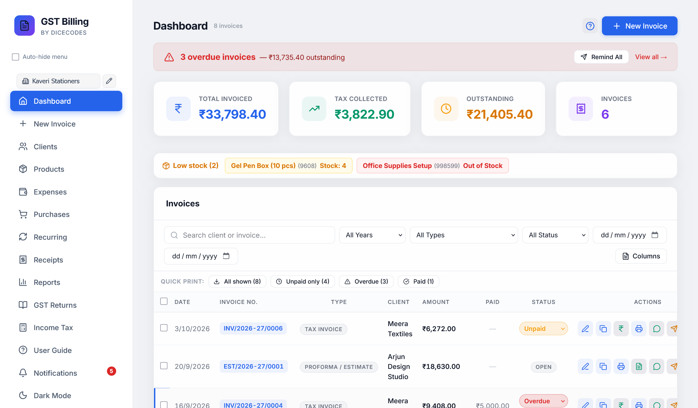
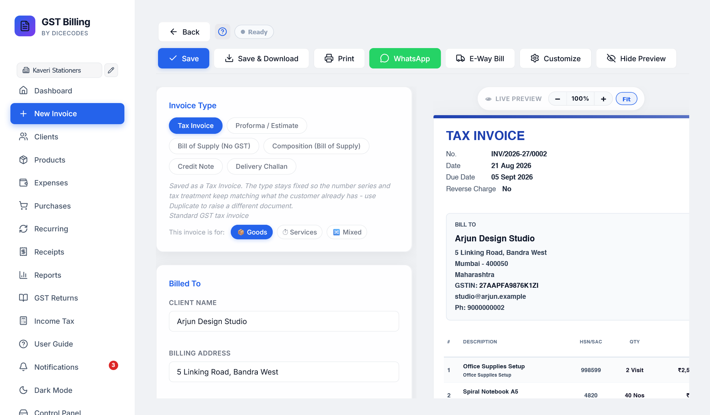
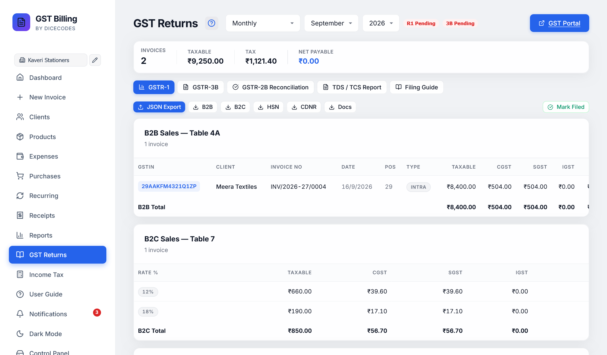
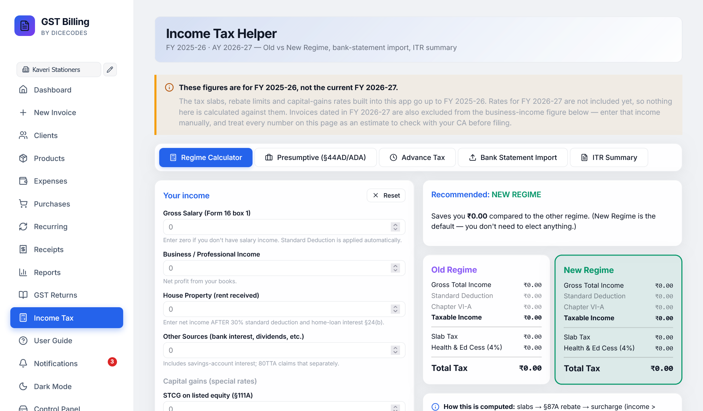
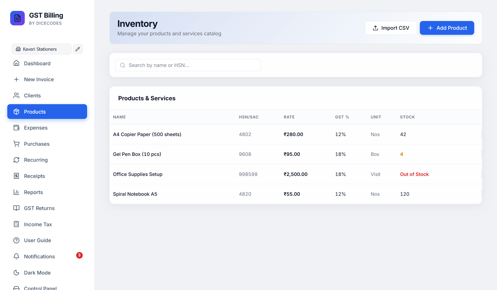

# Free GST Billing Software (Enterprise Desktop Edition)

[](LICENSE)
[](#installation--downloads)
[](https://react.dev)
[-black.svg)](https://expressjs.com)
[](https://www.electronjs.org)
[](#security-architecture)

> **Free, privacy-first, offline-native GST invoice & billing desktop software for Indian businesses, MSMEs, freelancers, and accounting teams.**
> 
> Features automated Tax Invoicing, GSTR-1 / GSTR-3B JSON exports, GSTR-2B purchase reconciliation, e-Way bills, TDS/TCS compliance, multi-currency support for 22 countries, rich-text terms, UPI QR code generation, and multi-business profiles with automated daily backups.

<p align="center">
  
</p>

---

## 🌟 Key Highlights

* **100% Offline & Private**: Zero external database or cloud subscription dependencies. All business records, invoices, customer lists, and financial figures reside in human-readable JSON files strictly on your machine.
* **Native Desktop Binaries**: Built for both **macOS (.dmg)** and **Windows (.exe / portable)** with native OS window controls, system menus, and hardware acceleration.
* **Comprehensive Indian Tax Engine**:
  * **Tax Invoices, Bills of Supply, Proforma Invoices, Delivery Challans, and Credit/Debit Notes**.
  * Dynamic GST auto-split (CGST + SGST/UTGST for intrastate, IGST for interstate, SEZ, and LUT exports).
  * Automated **TDS / TCS calculation** (Form 26Q / 27EQ, Section 194Q, Section 206C).
  * Reverse Charge Mechanism (RCM), Cess, per-line item custom units, and multiple discount modes (percentage, flat unit, with/without tax).
* **Government Portal Export Readiness**:
  * One-click **GSTR-1 and GSTR-3B JSON exports** formatted precisely for direct upload to the GST Portal.
  * **GSTR-2B Reconciliation** matching supplier invoices against internal books to maximize Input Tax Credit (ITC).
* **Instant Payments via UPI QR**: Automatically embeds dynamic, standard-compliant UPI payment QR codes on invoices linking directly to your VPA.
* **Enterprise Security Hardening**: Anti-DNS Rebinding host validation, strict loopback binding (`127.0.0.1`), scrypt-salted PIN lock with API session tokens, object prototype pollution defenses, and DOMPurify XSS sanitization.

---

## 📸 Application Showcase & Screenshots

### 1. Modern Financial Dashboard
Overview of monthly revenue, unpaid receivables, tax liability split (CGST, SGST, IGST), and recent transactions at a glance.
<p align="center">
  
</p>

---

### 2. Comprehensive Tax Invoice Generator
Create Tax Invoices, Proformas, and Delivery Challans with dynamic tax rate suggestions, instant UPI QR generation, multi-discount engines, and live invoice previews.
<p align="center">
  
</p>

---

### 3. GST Return Filing & Portal JSON Generation
Automated calculation of GSTR-1 (Table 4 B2B, Table 5 B2CL, Table 7 B2CS, Table 8 Nil/Exempt, Table 12 HSN Summary) and GSTR-3B tax liabilities with one-click official portal-compliant JSON generation.
<p align="center">
  
</p>

---

### 4. Advanced Income Tax & Capital Gains Calculator
Built-in tax planning engine supporting Budget 2025-26 rules, new vs old regime comparative analysis, Section 87A rebate calculations, and Section 234A/B/C advance tax interest.
<p align="center">
  
</p>

---

### 5. Client Directory, Aging & Ledgers
Track client GSTINs, state codes, credit limits, outstanding balances, and generate date-filtered customer statements.
<p align="center">
  
</p>

---

### 6. Inventory & Real-Time Stock Tracking
Manage product catalogs, HSN/SAC codes, low stock alerts, cost price vs selling price margins, and batch CSV imports.
<p align="center">
  
</p>

---

### 7. Professional Print & Template Formats
Choose between multiple industry-standard print styles including **Boxed Elegance**, **Tally-style Accounting Format**, **Modern Clean**, and **Thermal POS 80mm/58mm** formats.

| Boxed Elegance Template | Tally-Style Format |
| :---: | :---: |
|  |  |

<p align="center">
  
</p>

---

## 🏗️ System Architecture

```
┌───────────────────────────────────────────────────────────────┐
│               Native Desktop Window (Electron)                │
│       macOS (.dmg) / Windows (.exe) / Linux (AppImage)        │
│                                                               │
│   ┌───────────────────────────────────────────────────────┐   │
│   │              React 19 + Vite Frontend                 │   │
│   │   • Modern Glassmorphism UI & Dynamic Dark Mode       │   │
│   │   • PDF Engine: client-side pdf-lib & html2canvas     │   │
│   │   • OCR Engine: offline tesseract.js bill scanner     │   │
│   └──────────────────────────┬────────────────────────────┘   │
└──────────────────────────────┼────────────────────────────────┘
                               │ HTTP / JSON (Port 47371)
                               ▼
┌───────────────────────────────────────────────────────────────┐
│              Hardened Express 5 Offline Server                │
│                                                               │
│   • Anti-DNS Rebinding Host Validation (`localhost:47371`)    │
│   • Strict Loopback Network Binding (`127.0.0.1` only)        │
│   • Scrypt PIN Lock & Ephemeral Session Tokens                │
│   • Prototype Pollution Guard (`__proto__`, `constructor`)    │
│   • Path Traversal Defense (`safePathSegment` & `isPathInside`)│
│   • Atomic File Persistence (temp write + rename)             │
└──────────────────────────────┬────────────────────────────────┘
                               │ File I/O
                               ▼
┌───────────────────────────────────────────────────────────────┐
│                  Local Filesystem (`data/`)                   │
│                                                               │
│   ├── bills/            ├── receipts/      ├── backups/       │
│   ├── clients/          ├── recurring/     ├── trash/         │
│   ├── products/         ├── purchases/     └── meta.json      │
│   └── expenses/         └── profiles/                         │
└───────────────────────────────────────────────────────────────┘
```

---

## 🛡️ Security Architecture & Audit Report

This project has been statically audited using **REA (Reverse Engineer Anything)** to guarantee enterprise-grade protection for sensitive financial records:

| Threat Vector | Mitigation Strategy | Implementation |
| :--- | :--- | :--- |
| **DNS Rebinding** | Strict `Host` header validation | Rejects any request where `Host` does not match `localhost`, `127.0.0.1`, or `[::1]`. |
| **Cross-Origin Exfiltration** | Strict Origin whitelist | Cross-origin requests from external web browsers are intercepted and rejected with HTTP 403. |
| **Network Exposure** | Dedicated loopback binding | Server binds strictly to `127.0.0.1`; never listens on `0.0.0.0` or public interfaces. |
| **Prototype Pollution** | Blacklisted prototype accessors | Rejects keys matching `__proto__`, `constructor`, or `prototype` in dynamic routes (`/api/meta/:key`). |
| **Unauthorized Local Access** | Salted Scrypt + Session Tokens | PIN lock uses `crypto.scryptSync(pin, salt, 32)` with constant-time comparison (`timingSafeEqual`) and requires ephemeral session tokens for API access. |
| **Path Traversal (LFI/RFI)** | Two-tier path boundary verification | `safePathSegment` strips path delimiters and `..` sequences; `isPathInside` confirms final paths reside strictly within authorized directories. |
| **Stored XSS** | HTML Sanitization | All user-supplied rich-text terms, notes, and custom templates are sanitized via `DOMPurify.sanitize()`. |
| **Data Corruption** | Atomic disk writes | Database updates use `writeFileAtomic` (write to `.tmp` followed by atomic rename) to eliminate race conditions. |

---

## 💻 Installation & Downloads

### Option 1: Native Desktop Installers (.dmg / .exe)

* **macOS**: Download the `.dmg` file from [Releases](https://github.com/OmRaj6666/GST-Billing-Software-LIFE-TIME-USE-NO-Subscription-Required-/releases), open it, and drag **Free GST Billing** into your `Applications` folder.
* **Windows**: Download the `.exe` installer (or standalone portable `.exe`) from [Releases](https://github.com/OmRaj6666/GST-Billing-Software-LIFE-TIME-USE-NO-Subscription-Required-/releases) and double-click to launch.

*(To build the installers yourself from source, see [Building Desktop Packages](#building-desktop-packages) below).*

---

### Option 2: Portable Scripts (No Node.js install needed)

1. Download the latest release `.zip` from [Releases](https://github.com/OmRaj6666/GST-Billing-Software-LIFE-TIME-USE-NO-Subscription-Required-/releases).
2. Unpack the folder to any drive (e.g. `C:\Free-GST-Billing` or `~/Free-GST-Billing`).
3. Run the platform launcher:
   * **Windows**: Double-click `Free GST Billing - WINDOWS.hta`
   * **macOS**: Double-click `Free GST Billing - MAC.command`
   * **Linux**: Run `./Free GST Billing - LINUX.sh`

---

### Option 3: Developer Setup

```bash
# 1. Clone repository
git clone https://github.com/OmRaj6666/GST-Billing-Software-LIFE-TIME-USE-NO-Subscription-Required-.git
cd GST-Billing-Software-LIFE-TIME-USE-NO-Subscription-Required-

# 2. Install dependencies
npm install

# 3. Start development environment (Vite frontend + Express backend)
npm run dev

# 4. Open browser
http://localhost:47371
```

---

## 📦 Building Desktop Packages

Generate standalone `.dmg` and `.exe` binaries with a single command:

```bash
# Build desktop packages for current operating system
npm run build:desktop

# Build macOS installer (.dmg and .zip)
npm run build:mac

# Build Windows installer (.exe NSIS and portable .exe)
npm run build:win
```

Packaged installers and binaries will be output directly to the `./release-desktop/` directory.

---

## 🧪 Testing & Verification

The codebase includes comprehensive unit tests and browser-driven smoke tests:

```bash
# Run tax engine & calculation unit tests
npm run test:unit

# Run full Playwright browser smoke test suite
npm run test
```

Unit test coverage verifies:
* Intrastate vs Interstate tax splits (CGST + SGST vs IGST).
* Round-off accuracy for invoices up to ₹1,00,000+.
* Inclusive vs Exclusive GST back-calculation.
* Discount modes (percentage, fixed amount per unit, tax-inclusive discount).
* CSV bulk client and product import parsers.

---

## 📑 Tech Stack

* **UI Framework**: React 19, Vite 7, Lucide Icons, Modern Glassmorphism CSS
* **Backend**: Express 5.2.1 (ESM), Node.js >= 18
* **Desktop Layer**: Electron 35, Electron Builder 25
* **Document Assembly**: `pdf-lib`, `jspdf`, `html2canvas`, `qrcode`, `fflate`
* **Local OCR**: `tesseract.js` (offline bundled models)
* **Security & Crypto**: Node.js `crypto` (`scryptSync`, `timingSafeEqual`), `DOMPurify`

---

## 📄 License & Maintainer

This project is open-source under the **[MIT License](LICENSE)**.

* **Architect & Maintainer**: **OM RAJ**
* **GitHub Profile**: [@OmRaj6666](https://github.com/OmRaj6666)
* **LinkedIn Profile**: [om-raj-vit](https://www.linkedin.com/in/om-raj-vit/)
* **Email**: [omraj6666@gmail.com](mailto:omraj6666@gmail.com)


<p align="center">


" alt="Developer UPI QR Code" width="220" style="border-radius: 8px; border: 1px solid #e2e8f0; padding: 4px;" /><br/>
  <sub>Scan with any UPI app (GPay, PhonePe, Paytm, BHIM, SBI) to support ongoing open-source development.</sub>
</p>
